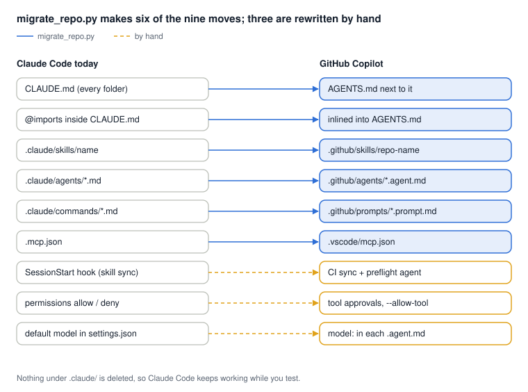
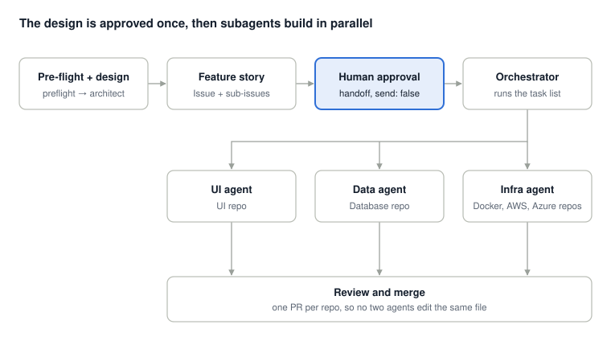

# Claude Code → GitHub Copilot migration kit

Move a multi-repo Claude Code setup (skills per repo, a central repo that collects them, a multi-agent feature flow) to GitHub Copilot.
Most files are read as they are; a few move; three need a rewrite by hand. The scripts do the moves and list the rest.

## 1. What moves where



| Claude Code | GitHub Copilot | How |
| --- | --- | --- |
| `CLAUDE.md` (root and nested) | `AGENTS.md` next to it | script; `CLAUDE.md` is kept |
| `@path` imports in `CLAUDE.md` | inlined into `AGENTS.md` | script; otherwise the agent reads the path as text and opens files on its own |
| `.claude/skills/<name>/SKILL.md` | `.github/skills/<repo>-<name>/` | script + lint of each `SKILL.md` |
| `~/.claude/skills` (personal) | `~/.copilot/skills` | copy by hand |
| `.claude/agents/*.md` | `.github/agents/<name>.agent.md` | script; add `model:`, map tool names |
| `.claude/commands/*.md` | `.github/prompts/<name>.prompt.md` | script; `$ARGUMENTS` → `${input:args}` |
| `.mcp.json` | `.vscode/mcp.json` (VS Code), `~/.copilot/mcp-config.json` (CLI) | script for VS Code |
| `SessionStart` hook (skill sync) | `preflight` agent, before every run | kit files below |
| `permissions` allow / deny | VS Code tool approvals, CLI `--allow-tool` / `--deny-tool` | by hand |
| default `model` | `model:` in each `.agent.md` | by hand |

## 2. Inside each SKILL.md

1. `name` and `description` in the frontmatter. Without them the file is read as a plain file, not a skill.
2. A description that says "Use when …" with the words developers type. The agent sees only the description until it loads the skill.
3. No Claude tool names ("use Bash", "use Read", "call Task"). Describe the action instead.
4. No `allowed-tools` or `$ARGUMENTS`: move tool limits to an agent's `tools:` and pass arguments in the prompt.
5. Script paths relative to the skill folder, not to the session's working directory.

`migrate_repo.py` flags all five.

## 3. The feature flow



| Claude Code | GitHub Copilot |
| --- | --- |
| Subagents and Teammates | Custom agents in `.github/agents`, called by `orchestrator` through its `agents:` list |
| Task tool with a ready-made prompt | The prompt in each `.agent.md` body. Keep it self-contained: a subagent does not see the parent conversation |
| Task list and dependency list | Task list with `depends_on`, run in waves; with `/fleet`, dependencies stated in the prompt |
| Approval before implementation | `handoffs` with `send: false` |
| Parallel run | VS Code subagents, CLI `/fleet`, or the cloud agent with one PR per sub-issue |

`AGENTS.md` holds a repo's instructions. A custom agent is a different file, `.github/agents/<name>.agent.md`; ready-made prompts go there.

**File locking.** `/fleet` has no file locking. One subagent per repo avoids collisions; edits to the central repo are made by the orchestrator alone.

## 4. Models

Compare like with like: Claude Code on a fixed model and effort against Copilot on the same model and effort (Auto off). Auto on Balance routes each request separately and may pick a lighter model.

| Task | Setting |
| --- | --- |
| Pre-flight, design, feature story | Plan mode; strong model pinned in `architect.agent.md`, or Auto on Intelligence; HydraFusion for the hardest designs |
| Implementation subagents | Pinned model per agent. A subagent cannot use a model more expensive than its parent |
| Routine edits | Auto on Balance or Efficiency |

Measure credits per finished task, not prompts per task.

## 5. Run it

| Stage | File | When |
| --- | --- | --- |
| Migrate a repo | `scripts/migrate_repo.py` | once per repo, dry run first |
| Collect skills | `scripts/sync_skills.py` | before every run, called by the preflight agent (optional: `.github/workflows/sync-skills.yml` runs it daily in CI) |
| Open the right repos | `workspaces/feature.code-workspace` | per feature |
| Start a feature | `.github/prompts/new-feature.prompt.md` (`/new-feature`) | every feature |
| Pre-flight | `.github/agents/preflight.agent.md` + `scripts/preflight.py` | start of every feature: skills sync, git pull, breaking changes, questions |
| Design + story | `.github/agents/architect.agent.md` | after pre-flight |
| Implement | `.github/agents/orchestrator.agent.md` → `ui`, `data`, `infra` | after approval |
| Implement in the CLI | `.github/prompts/fleet-implement.prompt.md` with `/fleet` | instead of the orchestrator |

```bash
# 1. migrate one repo (dry run, then apply)
python3 scripts/migrate_repo.py ../ui
python3 scripts/migrate_repo.py ../ui --apply      # writes files + MIGRATION_REPORT.md

# 2. collect skills from every repo in scripts/repos.txt into the central repo
python3 scripts/sync_skills.py --repos scripts/repos.txt --workdir .. --central . --apply

# 3. pre-flight on its own (the preflight agent runs this for you)
python3 scripts/preflight.py --repos scripts/repos.txt --workdir ..
```

Nothing under `.claude/` is deleted, so Claude Code keeps working while you test. The optional CI workflow needs a `SKILLS_SYNC_TOKEN` secret with read access to the repos. Model names in the agent files are examples; check the exact names in your model picker.

## 6. Checklist on one repo before rollout

- [ ] Only that repo open; `/skills` lists every expected skill with its own description
- [ ] A task that should trigger a skill loads it, without opening unrelated files
- [ ] No `@path` imports left in `AGENTS.md` or `CLAUDE.md`
- [ ] No `applyTo: "**"` instruction file with content meant for one area only
- [ ] Agents load from `.github/agents`, each with `model:`
- [ ] MCP servers start and authenticate
- [ ] `az` and other CLI calls run under your sandbox and approval settings
- [ ] Same design task, same model and effort in both tools: prompts to a good result, credits, reviewer rating
- [ ] Parallel run: no two agents edit the same file
